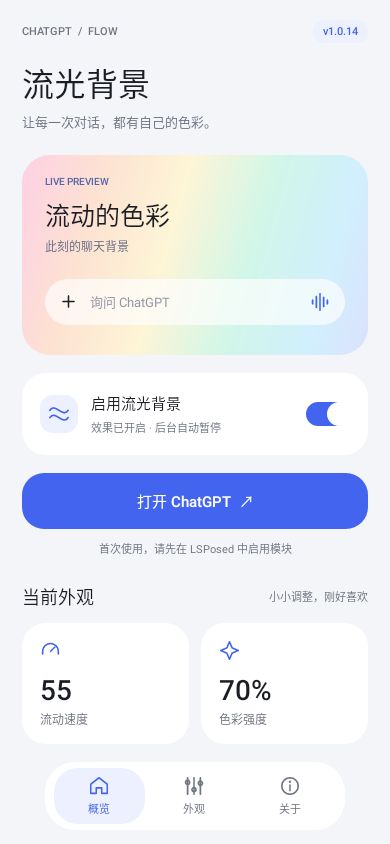
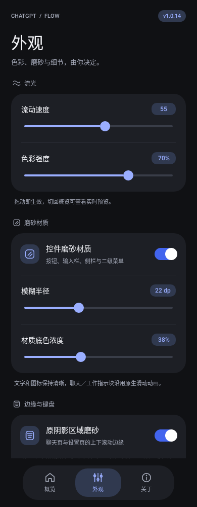

# ChatGPT 流光背景 · Flow

为 ChatGPT Android 添加循环流光彩色背景和可调磨砂材质的 LSPosed 模块。

## 功能

- 循环彩色背景，可调流动速度和色彩强度。
- 按钮、输入栏、侧栏、二级菜单及设置分组的磨砂材质。
- 聊天页、侧栏和设置页上下滚动阴影可替换为渐入磨砂。
- 可选键盘黑色遮罩兼容，默认关闭。
- 后台暂停动画，回到前台恢复。
- 模块 App 提供实时预览、深浅色适配，以及带左右过渡的底部导航。

## 界面

模块 App 在 Android 测试环境中的渲染预览：

| 概览 · 浅色 | 外观 · 深色 |
| --- | --- |
|  |  |

## 兼容性

| 项目 | 要求 |
| --- | --- |
| Android | 12L / API 32 及以上 |
| 框架 | 支持现代 libxposed API 102 的 LSPosed |
| 目标应用 | ChatGPT 1.2026.307，versionCode 2630709 |
| 作用域 | `com.openai.chatgpt` |
| 模块包名 | `io.github.northwolf8192.chatgptflow` |

适配器核对特定版本的 Compose 绘制入口；ChatGPT 更新后可能需要重新适配。

## 安装

1. 从本仓库 Releases 下载并安装 APK。
2. 打开模块 App，调整外观参数。
3. 在 LSPosed 中启用「ChatGPT 流光背景」，作用域选择 ChatGPT。
4. 强行停止 ChatGPT，再重新打开。

### 从早期测试版迁移

1.0.14 使用新包名和独立发布签名，会作为新的 App 安装。
保留旧版 `app.chatgpt.flow`，首次打开新版时会尝试读取旧模块的外观设置；
完成导入后，在 LSPosed 禁用旧版并启用新版，避免两个模块同时绘制。
新版的参数通过只读 ContentProvider 向目标进程提供。

## 外观参数

| 设置 | 默认值 | 范围 |
| --- | --- | --- |
| 流光背景 | 开启 | 开／关 |
| 流动速度 | 55 | 1–100 |
| 色彩强度 | 70% | 0–100% |
| 控件磨砂材质 | 开启 | 开／关 |
| 模糊半径 | 22 dp | 0–60 dp |
| 材质底色浓度 | 38% | 0–100% |
| 原阴影区域磨砂 | 开启 | 开／关 |
| 移除键盘黑色遮罩 | 关闭 | 开／关 |

“原阴影区域磨砂”关闭后保持去阴影效果。键盘兼容开启后收起并重新打开键盘。
磨砂采样模块自己的流光背景，不截取聊天消息的屏幕图像。

## 构建

准备 Java 17、Python 3 和网络。

```sh
python3 build.py --unsigned
python3 build.py --debug
```

正式签名构建需要设置 `FLOW_KEYSTORE`、`FLOW_KEYSTORE_PASSWORD_FILE`，可选 `FLOW_KEY_ALIAS`（默认 `chatgptflow`）。
签名密钥与密码文件放在源码目录外；CI 应使用加密 Secrets。

```sh
python3 build.py
```

构建脚本下载固定版本的 Android 编译存根、libxposed API、D8、apktool 和签名工具，运行颜色、材质策略、生命周期与几何测试。
APK 的 `assets/module-source.zip` 附带当前模块源码。源码包不含签名密钥、密码或原版 ChatGPT APK。

## 隐私与反馈

模块不申请网络权限，配置仅涉及视觉外观。反馈时请提供 ChatGPT 版本、Android／LSPosed 版本、出现问题的页面和模块日志；截图请先遮挡个人信息。

## 致谢与许可

模块设置界面的布局风格参考 [OShin](https://github.com/suqi8/OShin)，使用独立编写的原生 View 实现。
感谢 libxposed、LSPosed、apktool、R8 与 uber-apk-signer。

模块源码采用 [MIT License](LICENSE)。本项目由 NorthWolf8192 维护，与 OpenAI 无关联。
